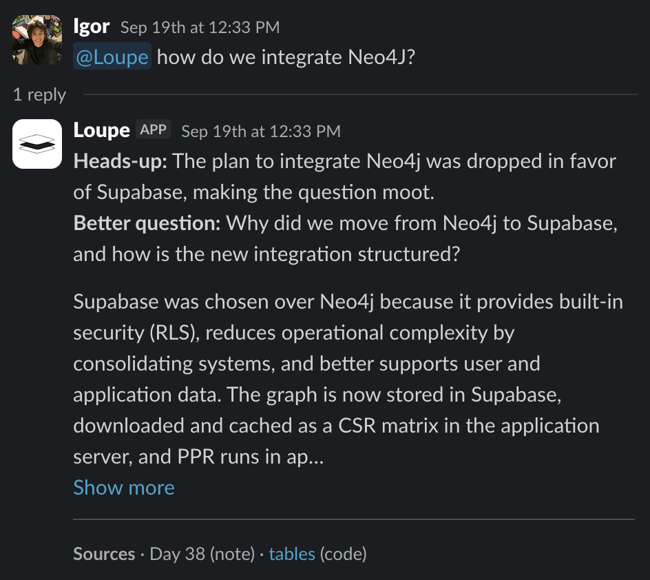
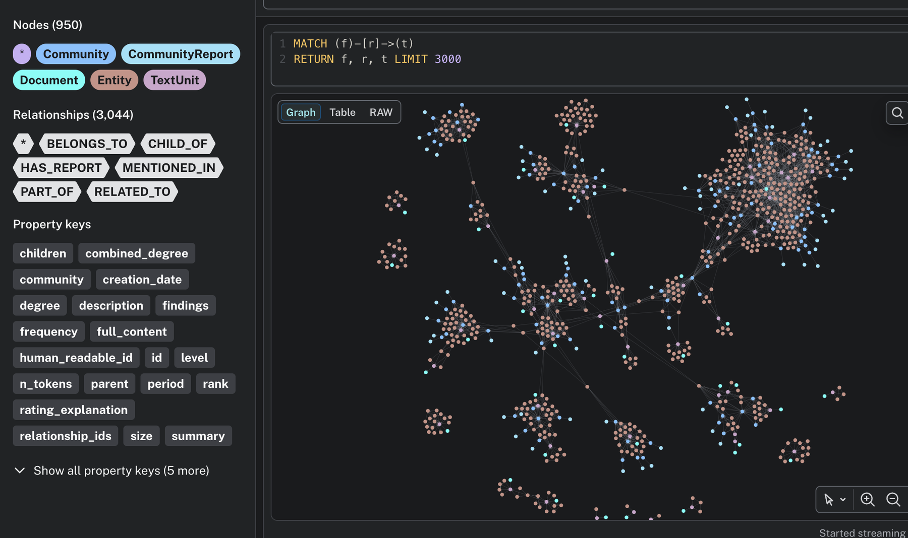
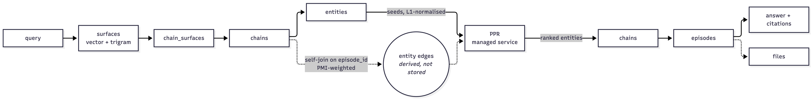
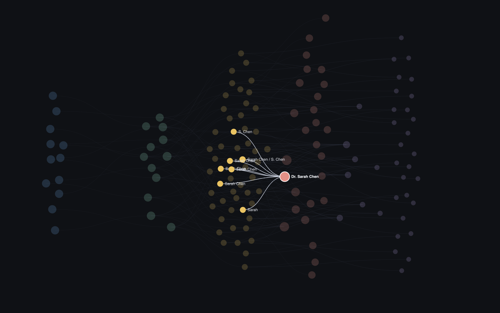
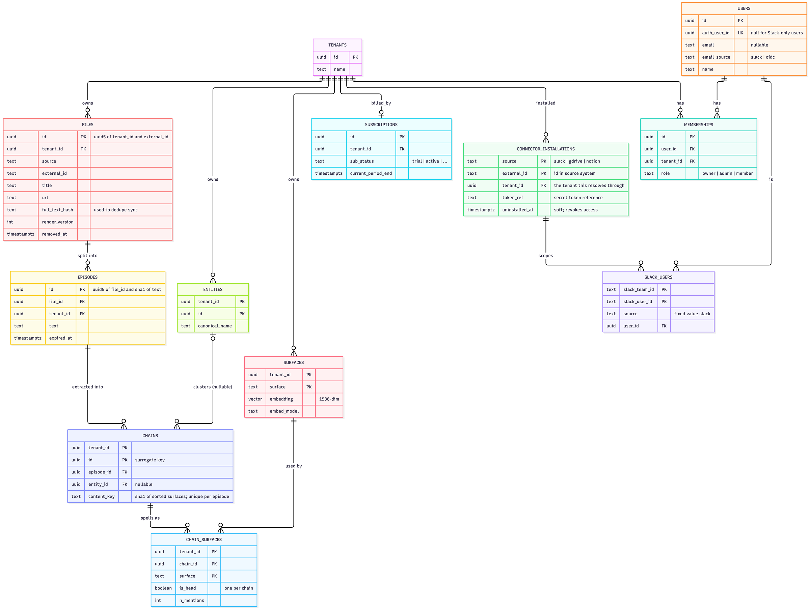
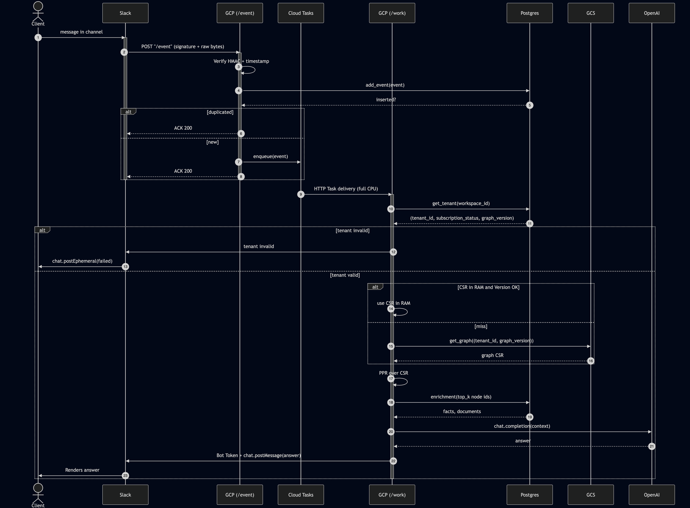

# graph-based-search-engine

A search engine over a team's Slack channels and other data, inspired by hippocampal index theory. Text is parsed into entities and relationships and stored as a graph index in Postgres.

Compared to plain RAG it:

- answers questions that use a different name for the same thing
- pushes back when a question's premise is wrong
- costs a tool-using agent fewer tokens in the typical run

Ask from a Slack thread or plug it in as an agent's search tool. Every answer cites the passages it came from. The product built on it: [graph-web-pi.vercel.app](https://graph-web-pi.vercel.app/).



*Asked in Slack with a premise the notes contradict. The bot says so, asks the better question, answers it, and lists the sources.*

<!-- TODO: demo GIF. Record ~15 s in Slack desktop, one channel: @mention the bot with a question
     about something in the indexed notes, show the holding reply, then the threaded answer
     with its citations. Export at 800 px wide, ~12 fps, under 3 MB, save as docs/demo.gif and
     add  above this comment. -->



*One indexed corpus as a graph: 950 nodes, 3,044 relationships. Entities are clustered into communities with their text units attached.*

## why care

Teams keep what they know in Slack threads and files. Keyword search doesn't know that "S. Chen", "Sarah" and "Dr. Sarah Chen" are one person, and neither keyword search nor plain RAG can answer an open question: to search well you're expected to already know what you're looking for. I believe storing information the way the brain (presumably) does is the way to go, a hippocampal index pointing into the content rather than a pile of chunks, so I built one. A lot of NLP for entity resolution and a lot of Postgres, but it worked. Along the way I wanted to find out how much an entity graph adds over dense retrieval, whether the same search cuts the tokens an agent burns grepping through a codebase, and whether I could build the multi-tenant plumbing properly rather than as a demo. This was an independent research project; the longer version of the why is on the [site](https://graph-web-pi.vercel.app/misc).

## run it locally

Needs `uv`. Anything that touches the database also needs the Supabase CLI and Docker (system-level installs). Extraction and answering call OpenAI.

```bash
cd server/public
uv sync                       # Python 3.13; pulls torch and the spaCy model wheel
cp .env.example .env          # OPENAI_API_KEY, SLACK_SIGNING_SECRET, SLACK_BOT_TOKEN, DATABASE_URL
uv run pytest                 # no database needed

# split one document into episodes without calling any model
uv run python -m src.inject.main --store out/store.json \
    --notes-dir ../../old_server/entity_linking/demos \
    --tenant-id 00000000-0000-4000-8000-000000000001 --dry-run

# the Slack ingress
uv run uvicorn src.app:app --port 8000   # GET /health, POST /slack/event
```

With a database (`supabase start` from the repo root, then set a password on the login roles the migrations create: `ALTER ROLE app_ingest_login PASSWORD '...'`), drop `--dry-run` and pass `--dsn`, then ask with `uv run python -m src.query.retrieve ask --tenant <uuid> "who owns the Okta rollout?"`. The tenant-isolation tests in `old_server/tests/` need the database up.

Env vars: `OPENAI_API_KEY`, `SLACK_SIGNING_SECRET`, `SLACK_BOT_TOKEN`, `DATABASE_URL`, `CONNECTOR_DATABASE_URL`, optional `GITHUB_TOKEN` for repo sync and `VERIFY_TIMESTAMP=false` for replaying through ngrok.

## how it works



**Ingest** (`server/public/src/inject/`): a document is split into ~1000-character episodes. spaCy builds a span inventory, and gpt-4.1-mini groups the spans into coreference chains, answering with span ids only so it can't invent text. Chains are embedded with nomic-embed-text-v1.5 and every candidate pair is scored on name cosine, string similarity, alias evidence and co-occurrence. Only the uncertain band goes to an LLM reviewer. Union-find clusters chains into entities, and everything lands in Postgres in one transaction.



*One entity after linking: "Sarah", "S. Chen", "Sarah Chen" and "Dr. Sarah Chen" from different documents resolved to one node, rendered straight from the Postgres rows.*

**Query** (`server/public/src/query/retrieve.py`): the question is embedded and matched to name surfaces (HNSW plus exact match), which seed entities. Personalized PageRank runs over co-occurrence edges derived at query time and weighted by PMI, the ranked entities' passages are fused with BM25, and gpt-4.1 answers, reframes a question whose premise the notes contradict, or asks which entity you meant. `search_passages()` returns the same ranked passages as plain text for an agent's search tool; `scripts/eval_agent_loop.py` measures a tool-using agent with and without it.

**Isolation** is the database's job: row-level security keyed on a per-transaction `SET LOCAL` context. The connector role can't claim a tenant; the database resolves it from the installation row. Schema in `supabase/migrations/`, reasoning in `ADRs/`, map in `wiki/`.



**Serving**: Slack posts to `/slack/event`, the signature is checked over the raw bytes, the event is deduped and acknowledged inside Slack's 3-second budget, and the answer is posted to the thread afterwards.



*Request flow from a message in a channel to the answer in its thread.*

`old_server/` is the earlier Neo4j version and the stage tests still live there.

## how the graph is wired

Deciding what an edge is. The first design stored edges and precomputed a CSR graph per tenant. I threw that out: there is no edges table. Two entities are connected when their chains share an episode, computed by a self-join at query time, and weighted by PMI with a floor of two co-occurrences. Raw counts let hub entities swallow the walk (precision on the synthetic rig 0.786, binary edges 0.000, PMI 0.931 with 58% fewer edges), and on real notes 94.8% of pairs co-occur exactly once, which is where the floor comes from. The cost is that PageRank is a Python-side sparse iteration over a join instead of a cached blob, so past some tenant size it needs the precomputed payload the ADRs describe and don't build. The graph also isn't a dense-retrieval replacement: dense wins at finding one passage, the graph wins at finding everything about an entity, including documents that only use an alias. Numbers and rigs: `wiki/measurements.md`.

## stack

Python 3.13, FastAPI, Postgres on Supabase (pgvector, pg_trgm, row-level security), psycopg, spaCy, nomic-embed-text-v1.5 via transformers/torch, hnswlib, scikit-learn, OpenAI (gpt-4.1-mini, gpt-4.1, text-embedding-3-large), Slack Events API, uv, pytest, ruff.

## license

[PolyForm Noncommercial 1.0.0](LICENSE): free for non-commercial use. Commercial use: contact me.
